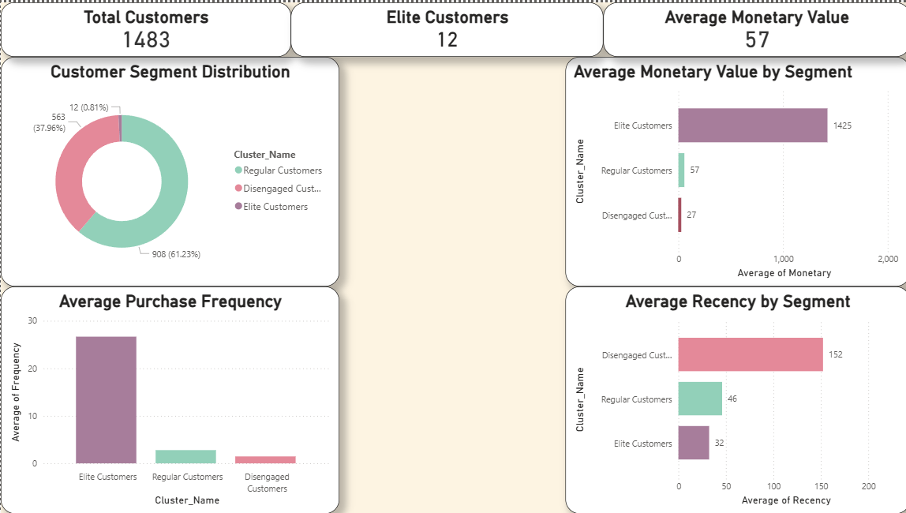
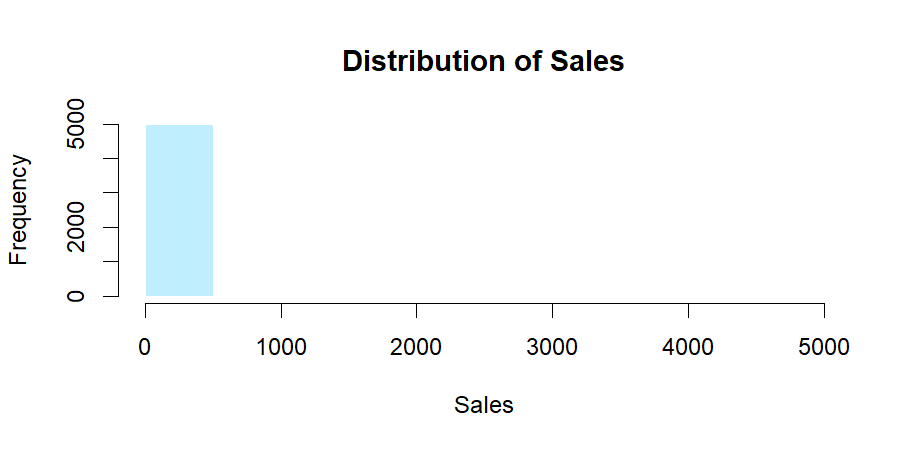
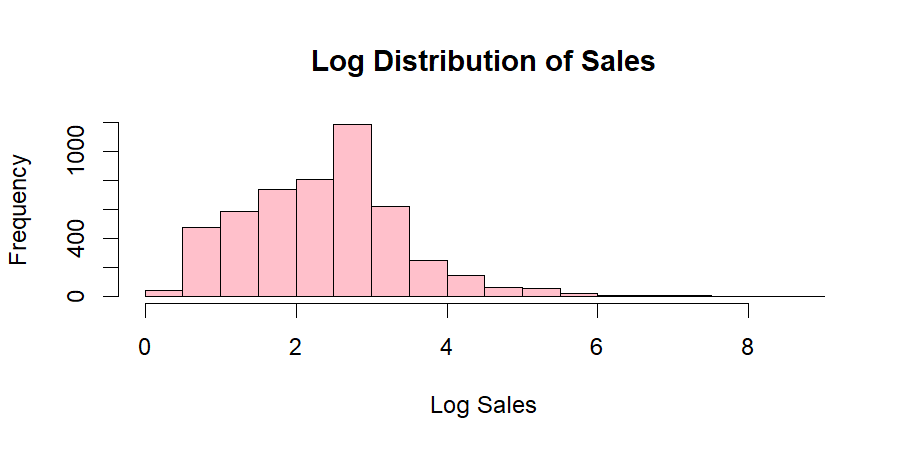
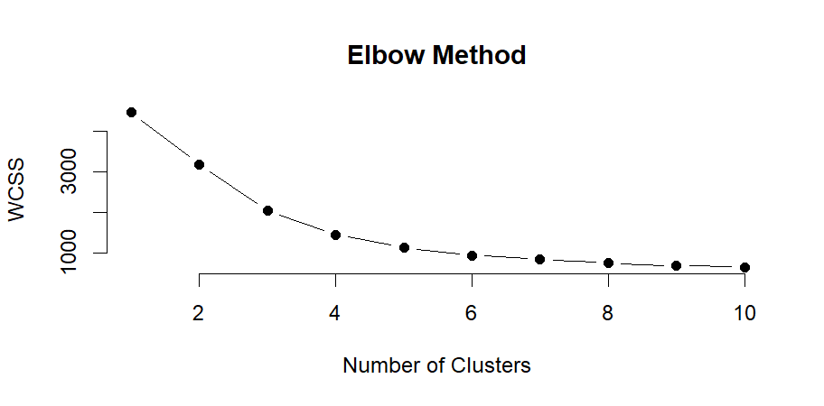
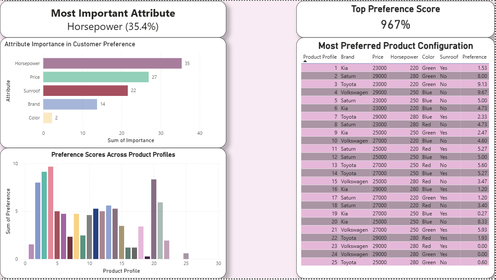
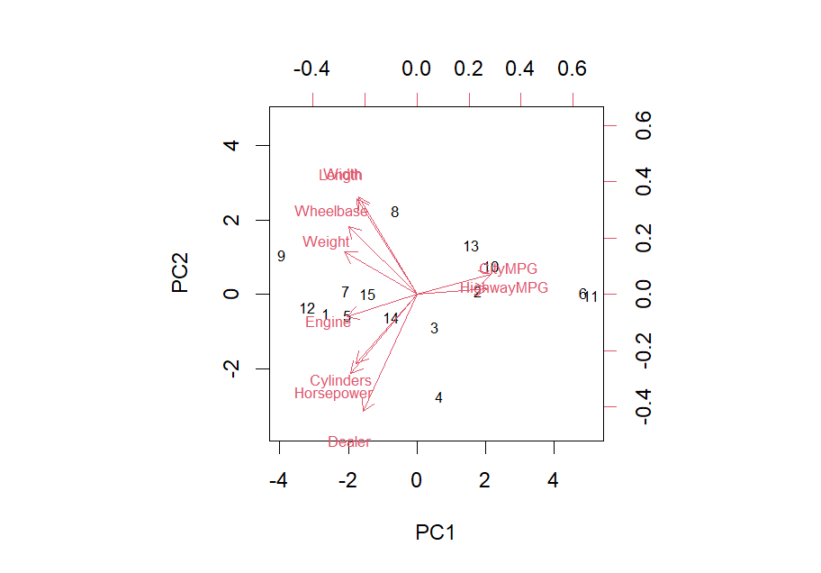

# Marketing Analytics: Customer Segmentation, Conjoint Analysis and PCA

An end-to-end marketing analytics project in R and Power BI. It covers three questions a marketing team would ask:

1. **Who are our customers?** Segment 1,483 customers by purchasing behaviour.
2. **What do buyers value in a product?** Estimate how much each car feature drives preference.
3. **How are products positioned?** Map 15 car models on the attributes that separate them.



## Key findings

- **A tiny group drives the value.** 12 customers (0.8%) average £1,425 in spend and 27 purchases each. The average across all customers is £57.
- **Behaviour beats demographics.** A discriminant model trained on age, income, household size, work and education placed every customer in the largest segment (61% accuracy, no better than guessing the majority). Targeting should rely on purchase behaviour, not demographics.
- **Horsepower matters most for car buyers** (35% of preference), followed by price (27%) and sunroof (22%). Colour barely registers (2%). Buyers preferred moderate power without a sunroof.
- **One dimension explains most of the car market.** The first principal component, performance versus fuel economy, explains 74% of the variation between models. Two components together explain 87%.

## 1. Customer segmentation and targeting

**Data:** 5,000 retail transactions with customer demographics, plus 2,000 prospective customers.

**Cleaning:** Recoded text "NA" customer IDs as true missing values, dropped 14 rows with no product description, converted invoice dates, and built a `Sales` field (quantity × unit price). Rolled transactions up to one row per customer.

**Exploration:** Sales are heavily right-skewed, with most transactions small and a few very large. A log transform brings the distribution close to normal.

| Sales distribution | Log sales distribution |
|---|---|
|  |  |

**RFM scoring:** Scored each customer from 1 to 4 on Recency, Frequency and Monetary value, using both independent and sequential sorting. Customers were then labelled as Champions, Loyal, Big Spenders, Potential, At Risk or Low Value.

**Clustering:** Standardised the RFM variables, explored the structure with hierarchical clustering, and used the elbow method to pick K-Means with three clusters.



| Segment | Customers | Avg recency (days) | Avg frequency | Avg spend (£) |
|---|---|---|---|---|
| Elite | 12 | 32 | 26.7 | 1,425 |
| Regular | 908 | 46 | 2.8 | 57 |
| Disengaged | 563 | 152 | 1.5 | 27 |

ANOVA confirmed that the segments differ significantly on all three RFM measures (p < 0.001). Recency separated them most strongly.

**Targeting:** Linear Discriminant Analysis tested whether demographics could predict a customer's segment, then scored the 2,000 prospects. Demographics turned out to be weak predictors, which is itself a useful result for deciding how to target new customers.

## 2. Conjoint analysis: what drives car preference

**Data:** 25 car profiles from a fractional factorial design (out of 288 possible combinations), each rated by 15 respondents.

**Method:** Ran a regression on the average ratings to estimate part-worth utilities for each attribute level (R² = 0.67). Converted utility ranges into relative attribute importance, then ranked every profile by predicted utility.

| Attribute | Importance |
|---|---|
| Horsepower | 35.4% |
| Price | 27.0% |
| Sunroof | 21.6% |
| Brand | 13.8% |
| Colour | 2.2% |

The top-ranked configuration was a 250 hp Volkswagen at 29,000 with no sunroof. Very high horsepower (280 hp) and a sunroof both lowered preference. Toyota had the strongest brand utility.



## 3. PCA perceptual map

**Data:** 15 car models described by dealer price, engine size, cylinders, horsepower, city and highway MPG, weight, wheelbase, length and width.

**Method:** Standardised all variables and ran PCA.

- **PC1 (74.4%):** performance versus economy. Engine size, cylinders, horsepower and weight point one way, and fuel efficiency points the other.
- **PC2 (12.8%):** physical size (width, length, wheelbase).



## Project structure

```
├── marketing_analytics.R        # Full analysis
├── data/                        # Input datasets and data dictionary
├── outputs/                     # Model outputs (feed the Power BI dashboard)
├── dashboard/                   # Power BI file
└── images/                      # Charts and dashboard screenshots
```

## How to run

1. Open the project folder in RStudio and set it as the working directory.
2. Install the packages if needed: `install.packages(c("readxl", "MASS", "tidyverse"))`
3. Run `marketing_analytics.R`. Results are written to `outputs/`.

**Tools:** R (tidyverse, MASS, readxl), Power BI
